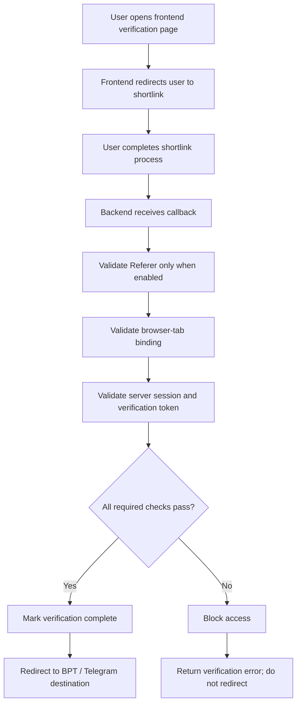

# Backend-authoritative verification flow

## Enforcement rules

- The frontend is for UI/navigation and supplies tab metadata. It never grants verification or access.
- `/api/verify` is the authorization point. It validates the token, signed browser session, flow expiry, and registered tab identifier before granting access.
- If the selected shortener has `referer_enabled: true`, the backend checks that the callback's `Referer` host matches the configured shortener host. Missing or mismatched referers are rejected.
- If `referer_enabled` is false or absent, referer validation is skipped. Tab, session, token, and expiry checks still apply.
- Any failed required check blocks access and prevents the success redirect.
- Configure a stable, high-entropy `SESSION_SECRET_KEY` in the deployment environment. Do not commit it to source control.

## Important limitations

Browser tab identifiers and Referer headers are supplemental signals, not cryptographic proof that a user stayed in one tab. Authorization relies on the signed server session, a short-lived verification token, and backend-side checks. Test the complete browser → shortener → callback → destination flow with each supported shortener before production use.
